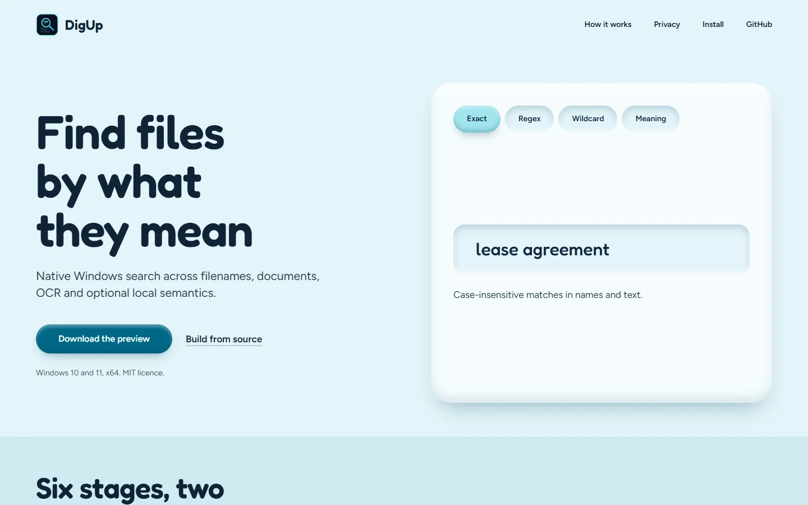
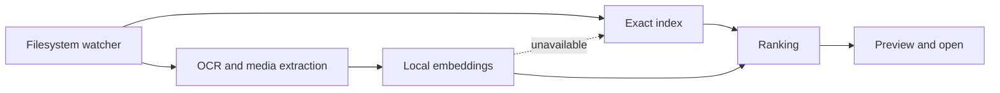

<p align="center"></p>

<h1 align="center">DigUp Windows</h1>

<p align="center"><strong>Find anything on Windows by what it means, not only what it's called.</strong></p>

<p align="center">
A native Rust desktop search tool for filenames, documents, OCR and optional local semantic search.
Exact search and extraction run entirely on your machine; semantic search uses an embedding server
that you configure.
</p>

<p align="center">
  <a href="https://github.com/boss477/digup-windows/actions/workflows/windows-validation.yml"></a>
  <a href="https://github.com/boss477/digup-windows/actions/workflows/ci.yml"></a>
  <a href="https://github.com/boss477/digup-windows/releases"></a>
  <a href="LICENSE"></a>
  
  
  <a href="https://boss477.github.io/digup-windows/"></a>
</p>

<p align="center"><a href="https://boss477.github.io/digup-windows/"></a></p>

<sub>The project page, with the search modes, the pipeline and the privacy boundary.</sub>

DigUp is a Windows preview. Exact search and document extraction run entirely on your machine.
Semantic search is optional and uses an embedding server that **you** configure.

## Contents

1. [How it works](#how-it-works)
2. [Features](#features)
3. [Install](#install)
4. [Optional components](#optional-components)
5. [Build from source](#build-from-source)
6. [Scripts](#scripts)
7. [Privacy boundary](#privacy-boundary)
8. [Documentation](#documentation)
9. [Contributing](#contributing)
10. [Acknowledgements](#acknowledgements)
11. [License](#license)

## How it works



If the embedding server is unavailable, DigUp falls back to exact search.

## Features

- Case-insensitive, regex, wildcard and folder search
- TXT, Markdown, RST, PDF, DOCX and ODT extraction
- Optional OCR and multimedia indexing
- Native folder watching and result previews
- Opens PDFs at the matching page and media at the matching timestamp (VLC)
- Windows per-user install and uninstall scripts that preserve your settings and data

For semantic search, use LM Studio or an OpenAI-compatible llama.cpp embedding server. For
EmbeddingGemma 2, DigUp applies the model's `SearchQuery` prompt to normal queries,
`CodeRetrieval` to source search, and titled `title: … | text: …` inputs to documents. The
configured server receives the request; use `localhost` to keep inference local.

## Install

1. Download `DigUpWindows-<version>-windows-x64-preview.zip` from the
   [latest release](https://github.com/boss477/digup-windows/releases/latest). Check it against
   `SHA256SUMS.txt`:

   ```powershell
   (Get-FileHash .\DigUpWindows-*-windows-x64-preview.zip -Algorithm SHA256).Hash
   ```

2. Extract the zip, then in PowerShell from the extracted folder:

   ```powershell
   ./check-prerequisites.ps1   # verifies x64 Windows and the VC++ runtime
   ./install.ps1               # per-user install, add -DesktopShortcut for a shortcut
   ```

To remove it, quit DigUp from its tray menu and run `uninstall.ps1`. Settings, vectors and models
are preserved.

The preview is **not code-signed**, so Windows SmartScreen may warn. Verify the checksum, then
choose **More info → Run anyway**.

## Optional components

Exact search needs nothing else. Add features as you need them:

| Feature                | How to enable                                         |
| ---------------------- | ----------------------------------------------------- |
| OCR (images, scanned)  | `./install-dependencies.ps1 -Ocr` (Tesseract, Poppler) |
| Audio/video indexing   | `./install-dependencies.ps1 -Media` (FFmpeg)           |
| Timestamp seeking      | `./install-dependencies.ps1 -VideoSeeking` (VLC)       |
| Local semantic search  | `./setup-llama.ps1`, then `./start-llama.ps1`          |

Tool locations can be overridden with `DIGUP_TESSERACT`, `DIGUP_PDFTOPPM` and `DIGUP_VLC`.

## Build from source

Requires Windows 10/11 x64, [Rust](https://rustup.rs) (stable), Visual Studio C++ Build Tools and
the Windows SDK.

```powershell
git clone https://github.com/boss477/digup-windows.git
cd digup-windows
./build.ps1      # fmt check, tests, clippy (warnings are errors), release build
./run.ps1
```

`./build.ps1 -TestsOnly` runs the checks without the release build.

## Scripts

| Script                                                                  | Purpose                                         |
| ----------------------------------------------------------------------- | ----------------------------------------------- |
| `build.ps1`, `run.ps1`                                                  | Build with all checks; run the release build    |
| `package.ps1`, `fetch-upstream-notices.ps1`, `collect-notices.ps1`      | Create the zip with third-party license notices |
| `install.ps1`, `uninstall.ps1`                                          | Per-user install and removal                    |
| `verify-package.ps1`, `verify-install.ps1`, `verify-clean-install.ps1` | Validate the package and installer behavior     |
| `verify-gui.ps1`, `verify-ocr.ps1`, `verify-media.ps1`, `verify-gpu.ps1` | Headless and hardware validation               |

For packaging, run `./fetch-upstream-notices.ps1` once, then `./package.ps1`.

### Releasing

Bump `version` in `Cargo.toml`, move the [changelog](CHANGELOG.md)'s Unreleased entries under it,
then tag:

```powershell
git tag v0.1.3
git push --tags
```

The [release workflow](.github/workflows/release.yml) runs the full validation, then publishes the
zip and `SHA256SUMS.txt` to a GitHub Release.

## Privacy boundary

Exact indexing and extraction run locally. Semantic and multimedia search send content to the
provider you configure; source files may contain secrets and `.gitignore` rules are not applied.
Use a `localhost` endpoint to keep everything on your machine. See [SECURITY.md](SECURITY.md).

## Documentation

- [Product design](DESIGN.md)
- [Security policy](SECURITY.md)
- [Changelog](CHANGELOG.md)

## Contributing

Issues and pull requests are welcome. Read [CONTRIBUTING.md](CONTRIBUTING.md) and the
[Code of Conduct](CODE_OF_CONDUCT.md) first.

## Acknowledgements

DigUp Windows is inspired by [ARahim3/DigUp](https://github.com/ARahim3/DigUp) by Abdur Rahim, the
cross-platform on-device search app built on Google DeepMind's EmbeddingGemma 2. Thanks for the
idea and the design. This project is an independent Windows-focused Rust implementation.

## License

[MIT](LICENSE) © boss477. Third-party notices ship in each release package.
