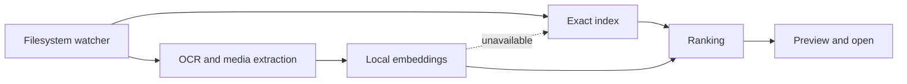

# DigUp Windows

> Find anything on Windows by what it means—not only what it’s called.

DigUp is a native Windows search tool for filenames, documents, OCR, and optional local semantic search.

## Search pipeline



## Features

- Case-insensitive, regex, wildcard, and folder search
- TXT, Markdown, RST, PDF, DOCX, and ODT extraction
- Optional OCR and multimedia indexing
- Native folder watching and result previews
- Windows per-user install and uninstall scripts

For semantic search, use LM Studio or an OpenAI-compatible llama.cpp embedding server. For EmbeddingGemma 2, DigUp applies the model's `SearchQuery` prompt to normal queries, `CodeRetrieval` to source search, and titled `title: … | text: …` inputs to documents. The configured server receives the request; use `localhost` to keep inference local.

## Build and run

```powershell
./build.ps1
./run.ps1
```

For packaging, run `./fetch-upstream-notices.ps1` once, then `./package.ps1`.

## Privacy boundary

Exact indexing and extraction can run locally. Semantic and multimedia search use the explicitly configured provider. This is a Windows preview with documented limitations.
